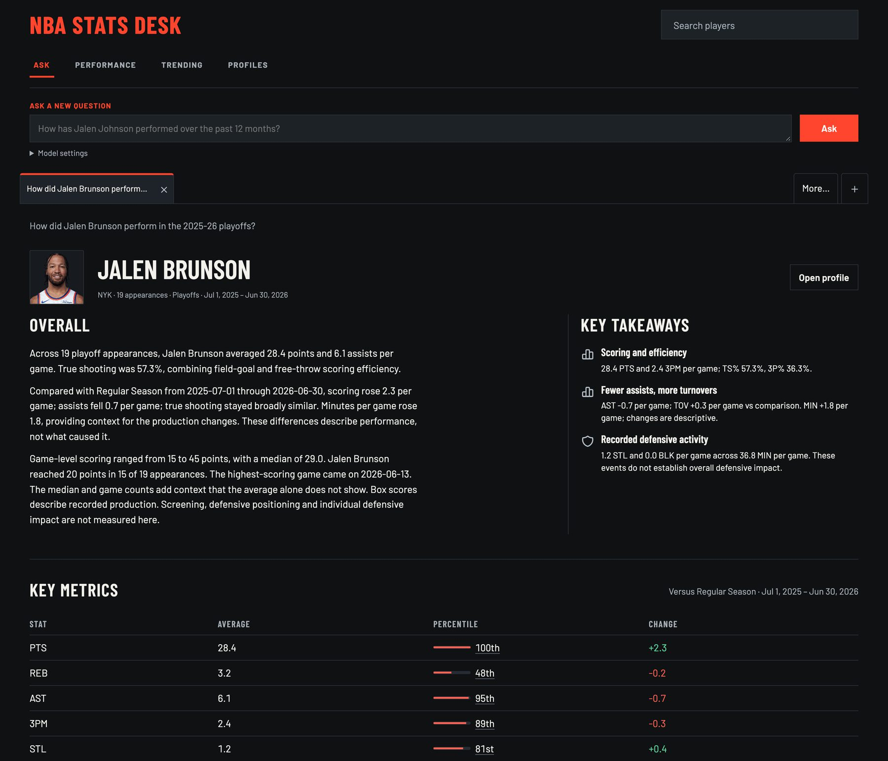
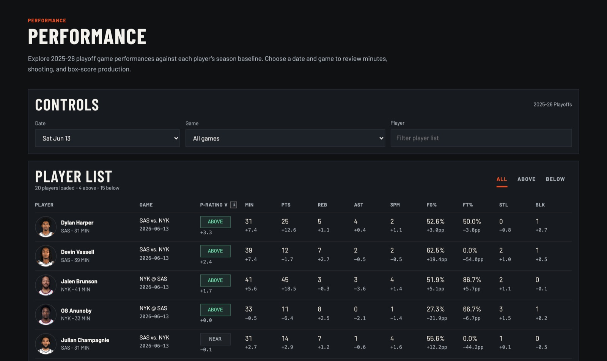
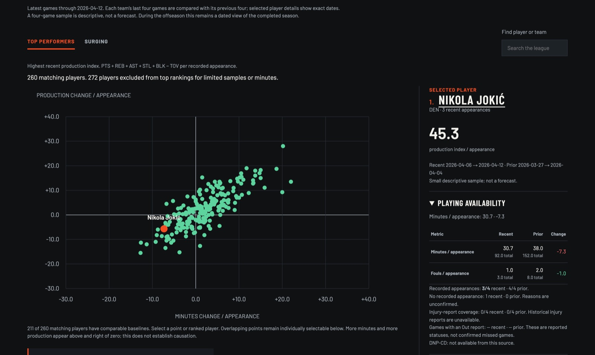
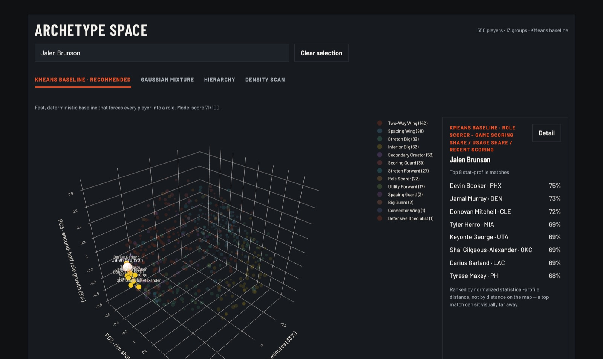

# NBA Stats Desk

[](https://github.com/mikeh-studio/nba-stats-desk/actions/workflows/ci.yml)
[](LICENSE)

NBA Stats Desk is an NBA analytics workbench and an engineering reference for
building evidence-backed data applications. Explore player performance and see
how scoped data, validated calculations and optional language planning fit together.

Under the hood, data contracts, dbt models and a semantic layer organize data in
BigQuery. Ask proposes plans for supported questions; the app validates and
executes them using governed calculations and read-only data access.



## Explore

| Experience | What it does |
| --- | --- |
| **Ask** (`/ask`) | Resolves players and dates, gathers evidence through bounded tools, and presents answers with comparison context and charts. See the [Ask contract](docs/ask-workspace.md). |
| **Players** (`/players`) | Browse and search players, then open profiles with trends, game logs, archetypes, percentiles, and [research breakdowns](docs/pages.md#players-and-research-breakdowns). Reached from the header search. |
| **Compare** (`/compare`) | Compare players across supported metrics and time windows. |
| **Performance** (`/performance`) | Compare playoff performances with season baselines; the optional publication view also supports regular-season games. |
| **Trending** (`/what-changed`) | Compare top performers and production changes across recent game windows. See [Trending](docs/pages.md#trending). |
| **Profiles** (`/similarity-map`) | Explore a 3D projection of statistical profiles, compare grouping models, and trace a player's nearest matches. See [profile similarity](docs/pages.md#statistical-profile-similarity). |

<table>
  <tr>
    <td width="50%"></td>
    <td width="50%"></td>
  </tr>
  <tr>
    <td align="center"><b>Performance</b>: playoff games against season baselines</td>
    <td align="center"><b>Trending</b>: production and minutes changes</td>
  </tr>
  <tr>
    <td colspan="2"></td>
  </tr>
  <tr>
    <td colspan="2" align="center"><b>Profiles</b>: archetype space and nearest matches</td>
  </tr>
</table>

The configured default is **2026–27**, with season selection back to **2023–24**.
Actual games, dates and features depend on the data available to the deployment;
the publication reader currently supports scoped 2026–27 regular-season data.
The screenshots above are historical examples. Teammate comparisons describe
observed differences and do not establish causation.

## How Ask answers a question

1. **Resolve scope.** Player names, dates, season, and regular-season/playoff
   phase are resolved explicitly. Ambiguous names ask for clarification instead
   of guessing.
2. **Gather evidence.** A planner proposes a route or plan; the app validates it
   and uses allowlisted, bounded, read-only lookups. The planner does not write SQL.
3. **Calculate in code.** Statistics follow the [semantic contract](docs/semantic-contract.md):
   pooled shooting ratios, valid-game denominators, and missing games kept
   separate from zero production.
4. **Answer from evidence.** Prose, tables, and charts share the same evidence.
   A chart model may only pick among server-built candidates; application code
   supplies every value.
5. **Decline what the data can't support.** For example, *"How did Jalen Brunson
   play in the 2026 NBA Finals?"* returns an explanation that individual playoff
   rounds aren't available yet. It does not quietly substitute the full playoff run.

## How data reaches the app

The project has an existing warehouse path and an opt-in publication path. Which
one a deployment uses depends on its configuration and available data.

The existing Airflow pipeline can collect NBA statistics and injury reports, retain
source records in GCS, validate and load them into BigQuery, and build bronze,
silver, gold and agent models with dbt. Injury-report availability is a separate
input to applicable features. The [architecture guide](docs/architecture.md)
describes this path; a DAG definition does not mean a scheduler is running.

The newer manual publication workflow prepares a unified candidate from source
records, checks its identities, scope, freshness and outputs, then publishes a
versioned BigQuery release when it passes. NBA API is the first choice; another
source such as ESPN can be used as a fallback only when permitted and configured.
Gamebooks can corroborate supported statistics. Source definitions and coverage
are kept explicit. A failed candidate does not replace the current release; the
previous release is usable only while its own freshness and authority remain valid.


The publication reader is **opt-in**: starting `app.main` alone does not enable it.
It requires operator-provided configuration, source authority and validation; the
code does not grant permission to use a data source. When enabled, supported core
Ask questions and selected Player, Compare and regular-season Performance views
use a pinned release. Other questions and existing page features retain their
existing sources. An unavailable publication is held; Ask can retry through its
existing service on a publication 503. See [publication reader scope and requirements](docs/core-production-preparation.md).

Ask's governed path validates plans and computes statistics in application code.
An optional model-backed planner can propose plans; it cannot supply SQL or
replace the host's validation. The deterministic reference planner works without
model credentials. See [how Ask works](docs/ask-workspace.md) and the
[provider contract](docs/intelligence-contract.md). Similarity profiles add a
public baseline and model comparisons using warehouse data.

Every pull request runs in CI:

- `ruff` linting and formatting, and `mypy` type checks
- Python and JavaScript tests
- Semantic-contract fixtures and an Ask endpoint harness over frozen evidence
- Browser checks of populated Ask flows
- `dbt parse`, Terraform validation, and public/private and acquisition boundary checks

## Documentation

| Guide | Covers |
| --- | --- |
| [Architecture](docs/architecture.md) | Existing pipeline flow, warehouse layout and serving |
| [Data sources](docs/data-sources.md) | Source roles, validation and coverage limits |
| [Publication reader](docs/core-production-preparation.md) | Opt-in release reader, supported routes, authority and freshness |
| [Synthetic core demo](docs/core-offline-replay.md) | Credential-free local replay and supported example questions |
| [Local Jobs monitor](docs/local-jobs-monitor.md) | Optional read-only local status and snapshot views |
| [Semantic contract](docs/semantic-contract.md) | Metric definitions, aggregation, qualification, and evidence boundaries |
| [Ask workspace](docs/ask-workspace.md) | How Ask plans, scopes, compares, and presents answers |
| [Evaluation](docs/evaluation.md) | Frozen inputs, the endpoint harness, and human review |
| [Pages](docs/pages.md) | Routes and the Players, Performance, Trending, and Profiles contracts |
| [Operations](docs/operations.md) | Local Airflow, source contracts, validation, backfills, and model catalog checks |
| [Public/private boundary](docs/public-private-boundary.md) | What stays in Git and what stays private |

## Repository map

| Path | Contents |
| --- | --- |
| `app/` | FastAPI app, Ask agent and tools, BigQuery repository, templates, and static assets |
| `dags/` | Airflow pipeline: extraction, staging, data-quality checks, merges, and publication |
| `dbt/` | Bronze, silver, gold, and Ask-specific models with tests |
| `contracts/` | Source and publication contracts, schemas, and synthetic examples |
| `infra/terraform/` | GCP infrastructure |
| `scripts/` | App launchers, backfills, study builders, evaluators, and repository checks |
| `tests/`, `tests_js/` | Python and JavaScript test suites and frozen fixtures |

## Public and private responsibilities

| Public repository | Separate private work and operations |
| --- | --- |
| Web app, serving interfaces, dbt models, source guards and a deterministic reference planner. Existing pipeline code remains available for compatibility and review. | Forward development of specified acquisition and unified-data paths, the manual producer workflow and the project’s optional model-backed provider. A public fork does not include the private producer or its operational configuration; other compatible providers can be installed separately. |
| Contracts, synthetic examples and public tests explain and exercise supported behavior. | Credentials, raw source and review records, user feedback, runtime state and generated artifacts stay outside Git in access-controlled storage. |

The precise ownership rules are in the [public/private boundary](docs/public-private-boundary.md)
and [acquisition path map](docs/acquisition-development-boundary.json).
Installing any optional Python provider gives it normal process privileges; the
[provider contract](docs/intelligence-contract.md) defines its interface, not a sandbox.

The app supports Cloud Run deployment; this repository does not imply an active
public deployment. Public serving is read-only and currently has no account system.
See the [public service guide](docs/pages.md#public-service) for deployment boundaries.

## Try it locally

### 1. Run the synthetic demo

This path uses two invented games and a fixed historical clock. It needs Python
3.11+, but no BigQuery account, source credentials or model key. The demo is a
small, deterministic publication replay, not a copy of live production data.

```bash
# To use your fork, substitute its clone URL.
git clone https://github.com/mikeh-studio/nba-stats-desk.git
cd nba-stats-desk
python3 -m venv .venv
source .venv/bin/activate
pip install -r requirements.txt
PYTHONDONTWRITEBYTECODE=1 PYTHON_DOTENV_DISABLED=1 python scripts/serve_core_replay.py
```

Open `http://127.0.0.1:8033/ask` and try **Test Player A total points**. You
should see an answer using the synthetic publication. Only the documented demo
question patterns are supported; see the [demo guide](docs/core-offline-replay.md).

### 2. Connect your own data

The normal app needs a GCP project with access to compatible, populated BigQuery
datasets and Application Default Credentials (or another supported Google Cloud
authentication method). Warehouse use can incur GCP charges. Data access and
redistribution remain subject to the source's terms; this repository does not
include production records or grant a source license. The
[operations guide](docs/operations.md) covers the existing pipeline and
[historical seasons](docs/operations.md#historical-seasons).

With the environment above activated:

```bash
cp .env.example .env
# Set BQ_PROJECT (or GCP_PROJECT_ID) and the BQ_DATASET_* values for your data.
uvicorn app.main:app --host 127.0.0.1 --port 8001 --no-proxy-headers
```

Open `http://127.0.0.1:8001`. `ASK_INTELLIGENCE_PROVIDER=reference` is the default;
it needs no model key and supports a narrower set of question patterns than a
model-backed planner. For model-backed planning, install a compatible provider,
set `ASK_INTELLIGENCE_PROVIDER` to its registered name, and configure that
provider's model and credentials. Setting an API key alone does not select it.
The [provider setup guide](docs/intelligence-runtime.md) explains selection and
limits; OpenRouter is covered by mocked tests only. Keep
`AGENT_HISTORY_ENABLED=false` for public deployments.

The normal app command above does not turn on the publication reader. To use a
release, configure the separate [publication launcher](docs/core-production-preparation.md)
and its authority and warehouse access. The private producer and its credentials
are not bundled with a public fork.

### Validate a change

After installing development dependencies (`pip install -r requirements-dev.txt`),
run `ruff check .`, `ruff format --check .`, `mypy`, and `pytest -q`. JavaScript
tests use `npm ci` followed by `npm run test:tracking`. See the full
[validation guide](docs/operations.md#validation) and check the
[contribution boundary](docs/public-private-boundary.md) before proposing changes.

## License

Code and documentation use the [MIT License](LICENSE). NBA data, logos, trademarks,
player headshots, and third-party content remain subject to their owners' terms.
